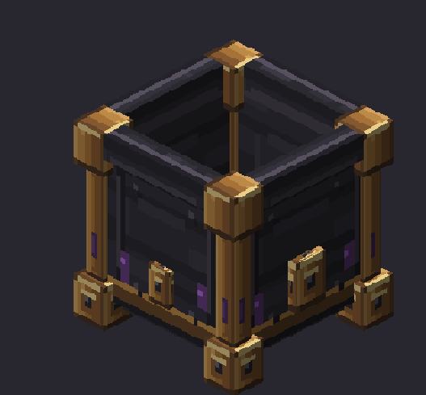

# Arcane Kinetics

The new name and Focusing Basin icon are applied to the project page and source. In-game branding will update in the next release.

[简体中文](README.md) · [Changelog](CHANGELOG.md) · [Modpack permission](MODPACK_PERMISSIONS.md)

A **Minecraft 1.21.1 / NeoForge** addon connecting Create with Iron's Spells 'n Spellbooks. Cast mechanical spells, automate spell processing and scroll printing, and power Create networks with a black-hole reactor.

The first public **0.3.0 Beta** is available on [GitHub Releases](https://github.com/chenlly118/Arcane-Kinetics/releases/tag/v0.3.0). Files are uploaded to [Modrinth](https://modrinth.com/project/create-spellbook); the new project is awaiting moderation. See the [release review](docs/PRE_RELEASE_REVIEW.md) for verification.

## Features

- A mechanical school with **14 spells** for combat, mining, processing, kinetic power and mechanical companions.
- A Focusing Basin, Enchanted Depot, Spell Sensor, Arcane Spell Emitter and automatic caster; processing integrates with Create depots, belts and sequenced assembly.
- A Scroll Printer using templates, school materials, native ink and paper.
- A 5–19 block cubic black-hole reactor with shared resources, kinetic output and instability accidents.
- An Engineer's Handbook, Enchanted Wrench, Arcane Crank, mana containers and materials.
- English and Simplified Chinese localization, **10 Ponder scenes**, and optional JEI recipe displays.

## Requirements

Install the same addon version on client and server. Use Java 21, Minecraft 1.21.1, NeoForge 21.1.251+, Create 6.0.9, Iron's Spells 'n Spellbooks 1.21.1-3.16.3, Curios 9.5.1, GeckoLib 4.9.3, Iron's Lib 1.21.1-2.2.0 and Player Animator 2.0.4+1.21.1. JEI 19.64.0.455 is optional. The declared Create range is [6.0.9,6.1), and the Iron's Spells range is [1.21.1-3.16.3,1.21.1-3.17); versions beyond the checked set are not individually tested. Create supplies Ponder, Flywheel and Registrate. Dependencies are installed separately.

This beta has not completed long factory stress tests, remote two-player acceptance or exhaustive third-party spell testing. An unstable reactor can damage the world; try it in a test world and keep backups. Some production recipes for Liquid Divine Soul and Arcane Mechanisms remain specific to the original modpack. See the [recipe format](docs/ARCANE_PROCESSING_RECIPES.md) for customization.

## Building

With JDK 21, run `./gradlew --no-daemon build` (`gradlew.bat` on Windows). Fixed dependencies download from public sources; the author's Minecraft installation and private caches are not required. The main artifact is `build/libs/create-spellbook-1.21.1-neoforge-0.3.0.jar`. Validate it with `python scripts/release_check.py --jar build/libs/create-spellbook-1.21.1-neoforge-0.3.0.jar`. See the review for actual local build results and remaining CI work.

## Licensing

Original code uses the author-confirmed [MIT license](LICENSE). Third-party material is governed separately; read [THIRD_PARTY_NOTICES.md](THIRD_PARTY_NOTICES.md) and the [licensing review](docs/LICENSING_REVIEW.md). [Modpacks are welcome](MODPACK_PERMISSIONS.md). Report issues with exact versions, reproduction steps and sanitized logs.
